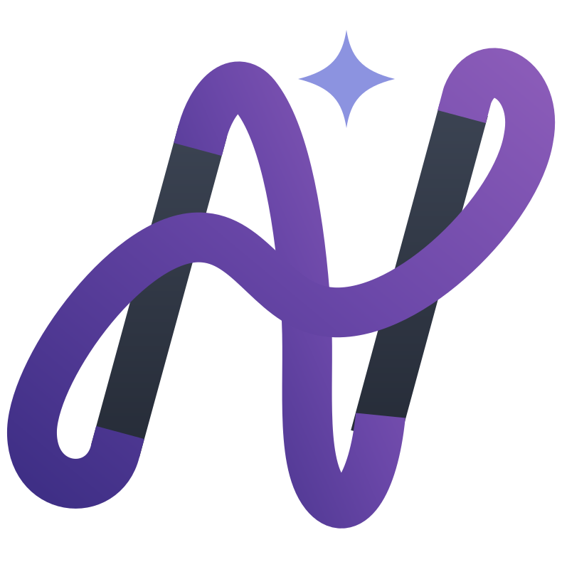

<p align="center">
  <picture>
    <source media="(prefers-color-scheme: dark)" srcset="apps/site/src/assets/logo-dark.svg" />
    
  </picture>
</p>

<h1 align="center">NovaProse</h1>

<p align="center">
  An embeddable rich text editor built on <a href="https://prosemirror.net">ProseMirror</a>: MIT licensed, with
  real-time collaboration, comments, version history and suggested edits built in.
  <br />
  <a href="https://novaprose.com">Website</a> ·
  <a href="https://novaprose.com/getting-started/">Documentation</a> ·
  <a href="https://novaprose.com/demo/collaboration/">Live demo</a>
</p>

> Status: 0.x preview. The API may change between minor versions. See [CHANGELOG.md](CHANGELOG.md).

## Quick start (development)

You need Node.js 22.23+ (or 24+) and pnpm 9 (`npm i -g pnpm`).

```bash
pnpm install
pnpm dev      # opens the playground at http://localhost:5173
pnpm check    # format, lint, types, tests
```

## Usage

```ts
import { createEditor } from '@novaprose/core';
import '@novaprose/core/style.css';

const editor = createEditor({
  element: document.querySelector('#editor')!,
  content: '<p>Hello, world</p>',
  placeholder: 'Start typing…',
  // The familiar toolbar format; '|' separates groups. What doesn't fit moves into "⋯".
  toolbar:
    'undo redo | blocks | bold italic underline | forecolor backcolor | link image | bullist numlist',
  // Image uploads go to your server (paste, drag and drop, the image dialog).
  uploadImage: async (file, progress) => {
    const body = new FormData();
    body.append('file', file);
    const res = await fetch('/upload', { method: 'POST', body });
    return (await res.json()).url;
  },
  // Your own buttons, with the same API as the built-in ones.
  setup: (editor) => {
    editor.ui.registry.addButton('signature', {
      text: 'Signature',
      tooltip: 'Insert a signature',
      onAction: (e) => e.setContent(e.getHTML() + '<p>Best regards</p>'),
    });
  },
  onChange: (e) => console.log(e.getHTML()),
});

editor.exec('bold');
editor.getHTML(); // deterministic HTML, the same in every browser
editor.destroy();
```

English is built in. Other interface languages are separate files, so each page downloads only its own:

```ts
import { registerLanguage } from '@novaprose/core';
import de from '@novaprose/core/i18n/de';

registerLanguage('de', de);
createEditor({ element, language: 'de' });
```

Restrict the content (like `valid_elements` / `invalid_elements` / `valid_styles`):

```ts
createEditor({
  element,
  invalidElements: 'img,table,h1', // or validElements: 'p,strong/b,em/i,a[href],ul,ol'
  validStyles: 'color,text-align',
});
```

Nothing that is not allowed gets into the document: not by pasting, keyboard shortcuts or `setContent`.

Modes and menus:

```ts
createEditor({ element, mode: 'inline' }); // no frame, the toolbar appears above the text on focus
createEditor({ element, mode: 'distraction-free' }); // contextual toolbars only (quickbars)
createEditor({ element, menubar: true }); // File · Edit · View · Insert · Format · Table · Help
```

Keyboard shortcuts: Ctrl/Cmd+B/I/U, Ctrl/Cmd+K for a link, Alt+F10 moves to the toolbar, Esc returns to the
text. Markdown while typing: `#`, `-`, `1.`, `>`, ` ``` `.

React:

```tsx
import { NovaProseEditor } from '@novaprose/react';
import '@novaprose/core/style.css';

function App() {
  const [html, setHtml] = useState('<p>Hello</p>');
  return <NovaProseEditor value={html} onChange={setHtml} init={{ menubar: true }} />;
}
```

Hooks for your own interface (`useEditor`, `useEditorState`, `useCommand`), forms and Next.js are described in
[packages/react/README.md](packages/react/README.md). React playground: http://localhost:5173/react.html.

Vue:

```vue
<NovaProseEditor v-model="html" :init="{ menubar: true }" />
```

More in [packages/vue/README.md](packages/vue/README.md); playground: http://localhost:5173/vue.html.

Without a framework, the web component works like any other form field:

```html
<script src="…/novaprose.global.js"></script>
<form method="post">
  <novaprose-editor name="body" required><p>Hello</p></novaprose-editor>
</form>
```

Angular (`ngModel`, Reactive Forms, zoneless, SSR):

```html
<novaprose-editor [formControl]="body" [init]="{ menubar: true }" />
```

More in [packages/angular/README.md](packages/angular/README.md); playground: http://localhost:5173/angular.html.

The web component is described in [packages/web-component/README.md](packages/web-component/README.md);
playground: http://localhost:5173/element.html.

## Repository layout

| Path                      | What it is                                                                       |
| ------------------------- | -------------------------------------------------------------------------------- |
| `packages/core`           | `@novaprose/core`: the editor                                                    |
| `packages/react`          | `@novaprose/react`: component and hooks                                          |
| `packages/vue`            | `@novaprose/vue`: component and composables                                      |
| `packages/web-component`  | `@novaprose/web-component`: the `<novaprose-editor>` element and CDN build       |
| `packages/angular`        | `@novaprose/angular`: component for ngModel and Reactive Forms                   |
| `packages/collab`         | `@novaprose/collab`: real-time collaboration                                     |
| `packages/tinymce-compat` | `@novaprose/tinymce-compat`: runs existing `tinymce.init()` configurations       |
| `apps/playground`         | playground for manual checks                                                     |
| `apps/sync-server`        | collaboration server (Docker)                                                    |
| `apps/site`               | the novaprose.com website                                                        |
| `examples`                | examples (React, Vue, CDN, server); checked before a release (`verify:examples`) |
| `docs/RELEASING.md`       | how releases are made                                                            |

## License

[MIT](LICENSE)
